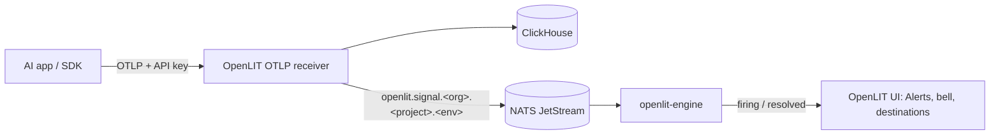

import EnterpriseFeature from '/snippets/enterprise-feature.mdx';

Open **Alerts** from the sidebar under **Monitor** (`/alerts`). There are two kinds of alert:

| Kind | Watches | Notifies | Edition |
| --- | --- | --- | --- |
| **Threshold** | Live GenAI spans: error rate, error count, span count, latency, tokens, cost | In OpenLIT (Alerts pages and the header bell). Enterprise adds Slack, email, webhooks, and other destinations | All editions |
| **Event** | Changes made in OpenLIT, such as access updates, API keys, Vault secrets, scanner results, or threshold alerts firing | Slack, email, PagerDuty, webhooks, and other destinations | Enterprise |

The Alerts area has these pages:

- **Overview** (`/alerts`): what is firing now, by severity, recent activity, and the most-triggered alerts. In Enterprise it also shows event alerts and notification delivery for the last 24 hours.
- **Alerts** (`/alerts/list`): every alert in the current project and environment. In Enterprise, the **Alerts** tab lists threshold and event alerts together with **All**, **Firing**, **Threshold**, and **Event** filters, and the **Activity** tab lists every notification sent.
- **Destinations** (`/alerts/destinations`, Enterprise): where notifications are sent.

Create an alert with the **+** button in the page header. Its menu lists the kinds of alert you can create.

<Frame>
  
</Frame>

## How threshold alerts work

Threshold alerts are evaluated on the live span stream, not by querying ClickHouse:



1. The [OTLP receiver](/latest/openlit/otlp-receiver#realtime-signals) writes each span to ClickHouse and, for GenAI spans sent with an API key, publishes a compact signal to NATS JetStream on a subject scoped to the organisation, project, and environment.
2. The bundled `openlit-engine` keeps a sliding window per alert and group, and checks every enabled alert every 5 seconds.
3. When an alert breaches or clears, the engine sends the change to OpenLIT, which records it and notifies.

A new or edited alert is picked up within about 10 seconds. Realtime needs `NATS_URL`; Docker Compose runs NATS by default. See [Realtime variables](/latest/openlit/configuration#realtime-variables).

Signals never include prompts, completions, or messages. Threshold alerts only see spans sent to the project with an [API key](/latest/openlit/otlp-receiver#authentication).

## Create a threshold alert

<Steps>
  <Step title="Start from a template">
    Select **+** in the header, or **New alert**. Pick a template (**Error rate spike**, **P95 latency breach**, **Token usage spike**, **Cost spike**) or **Blank**. A template only fills in the form; nothing runs until you save.

    <Frame>
      
    </Frame>
  </Step>
  <Step title="Name the alert">
    Under **Details**, enter a **Name**, an optional **Description**, and a **Severity** (info, warning, or critical).
  </Step>
  <Step title="Set the condition">
    - **Metric**: error rate, error count, span count, p95 latency, average latency, total tokens, or cost.
    - **Operator** and **Threshold**, for example `> 25` for cost in USD or `> 0.25` for a 25% error rate.
    - **Window**: the period the metric is computed over (1 minute to 1 hour in the form; 30 seconds to 1 hour through the API).
    - **Group by** (up to three fields): each value, such as each model or service, is tracked and alerted on separately. Pick fields with a bounded set of values (model, service, route). The engine tracks up to 1,000 groups per project environment, so grouping by a per-request value such as a response ID crowds out other alerts.
    - **Minimum spans** in the window before it can fire, and a **Cooldown** between two firings of the same group (at least 60 seconds).
  </Step>
  <Step title="Narrow it with span filters">
    Add **span filters** to evaluate only some spans, for example `model = gpt-4o` or `service in checkout-bot, search`. All filters must match, and text comparisons are case-insensitive. Operators: `=`, `≠`, `in`, `not in`, `exists`, `>`, `≥`, `<`, `≤`, and `contains`.
  </Step>
  <Step title="Choose who to notify and save">
    Under **Notify**, firing alerts always appear in OpenLIT. In Enterprise you can also pick destinations (see [Notify destinations](#notify-destinations)). The bar at the bottom describes the alert in plain language, for example *Fires when Cost > $25.00 over 5m · per model, for model = gpt-4o*. Turn **Enabled** off to save it paused, then select **Create alert**.
  </Step>
</Steps>

### Span fields and attributes

**Group by** and **span filters** use a searchable field picker:

- **Span fields**: `service`, `model`, `provider`, `operation`, `status`, `error_type`, `span_name`, and, for filters, the numbers `http_status`, `duration_ms`, `input_tokens`, `output_tokens`, `total_tokens`, and `cost`.
- **Span attributes**: common keys such as `gen_ai.tool.name` or `http.route`, plus the attribute keys seen on this project's spans in the last 24 hours.
- **Any other key**: type it, for example `app.tier` or `k8s.namespace.name`, and select **Use attribute**.

<Frame>
  
</Frame>

Span and resource attributes both work (span values win), up to 64 per span, with values truncated to 256 bytes and credential-like values redacted. Some keys are restricted:

- **Never available**: keys containing `prompt`, `completion`, `message`, `content`, `secret`, `password`, `authorization`, `api_key`, `credential`, `cookie`, `bearer`, or `instruction`.
- **Personal keys, off by default**: any key with a `user`, `enduser`, `session`, `conversation`, `email`, `phone`, `ip`, `address`, or `path` segment, such as `user.id`, `session.id`, `url.path`, or `server.address`. List the keys you need in [`OPENLIT_SIGNAL_ATTRIBUTES`](/latest/openlit/configuration#realtime-variables); until then, saving an alert that uses one returns `400`.

### Firing and resolved

Each group an alert fires for, such as one model, is tracked separately as a **finding**:

- **Firing**: the metric over the window breaches the threshold and the window has at least the minimum spans. A group fires again only after its cooldown.
- **Resolved**: the metric over the window no longer breaches, for example because the slow or failing spans aged out of the window. If it breaches again, the same finding reopens.

Resolved history is kept for 30 days by default (`OPENLIT_REALTIME_FINDING_RETENTION_DAYS`). Each environment can have up to 1,000 firing groups at once (`OPENLIT_REALTIME_MAX_OPEN_FINDINGS`); beyond that, new groups are not recorded.

### Alert details

Select an alert to open it. The header shows its status, severity, condition, filters, how many groups are firing now, and when it last fired. The tabs show:

- **Activity**: every group the alert fired for, with its state, value, first and last seen, when it resolved, and how many times it fired. Filter by **All**, **Firing**, or **Resolved**.
- **Live spans**: the latest spans that match the alert's span filters. Select a span to open the same trace view as Telemetry in a side panel, or select **Full screen** for the trace page.
- **Configuration**: the saved condition, group by, minimum spans, cooldown, span filters, and the engine rule ID.

In Enterprise, the detail page also lists the **Notifications** this alert sent and the result for each destination.

<Frame>
  
</Frame>

### Notify destinations

<EnterpriseFeature />

With the **Alerts** feature, the **Notify** section of a threshold alert lists your organisation's destinations. Select **Add destination** to create one without leaving the form. For each selected destination you can set:

- **Active for this alert**: turn it off to keep the destination attached without sending to it.
- **Start from a template**: **Summary**, **Incident detail**, or **Short** fill in the title and message.
- **Channel** (Slack): overrides the connector's default channel for this alert.
- **Title template** and **Message template**.
- **Card style** (Default, Compact, Detailed, or Incident) and an **Accent** colour.
- **Include matched payload fields** in the notification.

<Frame>
  
</Frame>

Templates can use `{{alert.name}}`, `{{alert.severity}}`, and these payload fields:

| Variable | Value |
| --- | --- |
| `{{payload.message}}` | A readable summary, for example *Demo cost spike is firing for model: gpt-4o: cost 36 vs threshold 25 (production).* |
| `{{payload.event}}` | `realtime_finding_opened`, `realtime_finding_reopened`, or `realtime_finding_resolved` |
| `{{payload.state}}` | `firing` or `resolved` |
| `{{payload.rule_name}}`, `{{payload.severity}}`, `{{payload.environment}}` | The alert's name, severity, and environment |
| `{{payload.metric}}`, `{{payload.value}}`, `{{payload.threshold}}` | What breached, the observed value, and the threshold |
| `{{payload.group.<field>}}` | The group value, such as `{{payload.group.model}}` |
| `{{payload.occurrences}}`, `{{payload.first_seen_at}}`, `{{payload.last_seen_at}}` | How often and when the group fired |

A notification is sent when a group starts firing, fires again, and resolves. Destinations without a template send `{{payload.message}}`. Each delivery is listed on the alert and in **Alerts → Activity**.

Without the Alerts license, the **Notify** section shows that destinations are locked, and threshold alerts keep notifying in OpenLIT.

## Event alerts

<EnterpriseFeature />

Event alerts notify your team when something important changes in OpenLIT, such as a member's access changing, an API key being created, a Vault secret being deleted, a scanner finishing with findings, or a threshold alert firing in any project. Each alert watches one or more **triggers**, filters them with optional **conditions**, and delivers to one or more **destinations** like Slack, PagerDuty, or a webhook.

### Create an event alert

<Steps>
  <Step title="Add a destination">
    Open **Destinations** and select **Add destination**, or select **Add destination** while creating an alert. Choose a provider and fill in its settings. See [Notification connectors](/latest/openlit/connectors/notification) for the fields each provider needs. Destinations are shared by every alert in the organisation.
  </Step>
  <Step title="Switch to Event">
    Select **+** in the header and choose **Event alert**, or open **New alert** and select **Event** at the top of the form. The form switches in place; **Threshold** is selected by default.

    <Frame>
      
    </Frame>
  </Step>
  <Step title="Describe the alert">
    Under **Details**, enter a **Name**, a **Severity** (low, medium, high, or critical), a **Status** (**Active** or **Paused**), and an optional **Description**.
  </Step>
  <Step title="Choose triggers">
    Under **Trigger**, pick one or more triggers. The alert fires when any selected trigger matches its own conditions. Leave **Conditions** empty to fire on every event of that trigger.
  </Step>
  <Step title="Pick destinations">
    Under **Destinations**, select where to send the alert and customise each destination's message in the same way as for [threshold alerts](#notify-destinations).
  </Step>
  <Step title="Set delivery options and save">
    Under **Delivery**, set **Cooldown seconds** (default 300) and an optional **Dedupe key**, then select **Save**. Use the send button on the alert to send a test notification.
  </Step>
</Steps>

### Conditions

Conditions narrow when a trigger fires. Each trigger has its own condition groups:

- Every group with conditions must match, and within a group you choose whether conditions are combined with **AND** or **OR**.
- Text fields support equals, not equals, contains, not contains, starts with, ends with, regex, in, and not in. For **in** and **not in**, separate values with commas.
- Number fields support `=`, `≠`, `>`, `≥`, `<`, `≤`, and **between** (enter `min,max`).
- Text fields suggest values that OpenLIT has already seen for that trigger, and you can type your own.

For example, to alert only when someone grants full access to an API key, use the **API keys** trigger with the conditions `event` equals `api_key_access_updated` and `access` equals `full`.

Event message templates can use `{{alert.id}}`, `{{alert.name}}`, `{{alert.severity}}`, `{{event.id}}`, `{{event.triggerType}}`, `{{payload.message}}`, and `{{payload.<field>}}` for any trigger field.

### Triggers

| Trigger | Fires on | Fields you can filter on |
| --- | --- | --- |
| **Access updates** | A member's project access, role, or direct permissions change | event, target email, target user ID, actor email, old role, new role, project count, project IDs, permission count, permissions |
| **Invites** | A member is invited or added | event, email, invitee email, actor email, role, project count |
| **Prompt versions** | A prompt version is created or updated | event, prompt ID, version, status |
| **Fleet Hub configuration** | A Fleet Hub agent configuration changes | event, agent ID, config key |
| **Vault keys** | A Vault secret is created, updated, or deleted | event, secret ID, key |
| **Contexts** | A context is created, updated, or deleted | event, context ID, name, status |
| **Rule engine** | A rule is created, updated, or deleted, its conditions change, or an entity is linked or unlinked | event, rule ID, rule name, status, entity type |
| **Memories** | A memory is created, updated, or deleted | event, memory ID, source type, application |
| **API keys** | An API key is created or deleted, or its access changes | event, name, environment, access (`full` or `restricted`), features |
| **Connectors** | A connector is created, updated, or deleted | event, connector ID, name, type, environment |
| **Scanners** | A scanner is created, updated, or deleted, or a scan finishes | event, scanner ID, name, type, environment, target, status, finding count |
| **Realtime findings** | A threshold alert starts firing, fires again, or resolves | event, rule ID, rule name, severity, kind, environment, state, metric, value, threshold |

### How delivery works

When a matching change happens, OpenLIT records an **alert event** and sends it to every active destination attached to the alert.

- **Cooldown:** an alert doesn't fire again until **Cooldown seconds** have passed since its last event. Set `0` to turn cooldown off.
- **Dedupe key:** when set, repeated events with the same key are dropped within the cooldown window, or within 300 seconds if cooldown is off.
- **Retries:** a failed delivery is retried once after 2 seconds.
- **Paused alerts** don't fire.

Each event ends in one of these states: **success** (all deliveries succeeded), **partial_failure** (some failed), or **failure** (all failed, or the alert has no destinations).

## Review notifications

<EnterpriseFeature />

**Alerts → Activity** shows a timeline of notifications from every alert, threshold and event, and a list you can filter by status, trigger, alert, provider, and delivery status. Select an event to see its payload, the conditions that matched, and the result of each delivery. Alert events are kept for 90 days. The old `/alerts/events` address opens this tab.

<Frame>
  
</Frame>

The **Overview** adds an **Event alerts and notifications** section: active event alerts, notifications sent in the last 24 hours, how many were delivered or failed, the delivery timeline, and the latest notifications.

<Frame>
  
</Frame>

## Availability

| Capability | Community | Enterprise |
| --- | --- | --- |
| Threshold alerts, findings, live spans, in-app notifications and header bell | ✓ | ✓ |
| Threshold alert destinations and message templates | | ✓ (**Alerts** feature) |
| Event alerts, Activity tab, destinations | | ✓ (**Alerts** feature) |

Event alerts and destinations need an [OpenLIT Enterprise](/latest/openlit/enterprise) license that includes the **Alerts** feature. Sending to destinations such as Slack or PagerDuty uses [notification connectors](/latest/openlit/connectors/notification), which are premium connectors and also need the **Premium connectors** feature. Without the Alerts license, event alerts and destinations are locked and their APIs return `403` with `upgrade_required`.

<Frame>
  
</Frame>

## Permissions

In Community, every signed-in member of a project can view and manage its threshold alerts. In Enterprise, these permissions apply to both kinds of alert:

| Permission | Allows | Default roles |
| --- | --- | --- |
| `alerts:read` | View alerts, findings, notifications, and destinations | Owner, Admin, Member |
| `alerts:create` | Create alerts | Owner, Admin |
| `alerts:update` | Edit, pause, and resume alerts | Owner, Admin |
| `alerts:delete` | Delete alerts | Owner, Admin |
| `alerts:test` | Send test alerts | Owner, Admin |
| `alerts:manage_destinations` | Add, edit, and delete destinations | Owner, Admin |

With [RBAC](/latest/openlit/rbac), you can grant these to custom role groups.

## Threshold alerts API

Requests act on the current project and the environment in the `x-openlit-environment` header (default `production`); the organisation, project, and environment are never read from the body. In Enterprise, each endpoint needs the matching `alerts:*` permission.

| Endpoint | Description |
| --- | --- |
| `GET /api/alerts/threshold` | List threshold alerts with status, firing groups, and last trigger time |
| `POST /api/alerts/threshold` | Create a threshold alert |
| `GET`, `PATCH`, `DELETE /api/alerts/threshold/{id}` | Read, update (send `{ "enabled": false }` alone to pause), or delete an alert and its history |
| `GET /api/alerts/threshold/{id}/findings` | Firing and resolved history (`state`, `limit`) |
| `GET /api/alerts/threshold/{id}/signals` | Recent spans that match the alert's span filters |
| `GET /api/alerts/threshold/{id}/deliveries` | Notifications this alert sent, with per-destination results (`limit`, Enterprise) |
| `GET /api/alerts/threshold/overview` | Counts, firing by severity, recent activity, and most-triggered alerts |
| `GET /api/alerts/threshold/templates` | Templates used by the New alert form |

The request body for create and update:

```json
{
  "name": "gpt-4o cost above budget",
  "severity": "critical",
  "enabled": true,
  "definition": {
    "metric": "cost",
    "operator": "gt",
    "threshold": 25,
    "windowSec": 300,
    "minSamples": 1,
    "cooldownSec": 900,
    "groupBy": ["model"],
    "match": [{ "field": "model", "op": "eq", "values": ["gpt-4o"] }]
  },
  "delivery": {
    "destinations": [
      {
        "destinationId": "<destination id>",
        "overrides": {
          "titleTemplate": "{{payload.rule_name}}: {{payload.state}}",
          "messageTemplate": "{{payload.message}}",
          "channel": "#oncall",
          "cardStyle": "incident",
          "accentColor": "#e11d48",
          "includeFields": false,
          "enabled": true
        }
      }
    ]
  }
}
```

- `metric`: `error_rate`, `error_count`, `count`, `p95_latency_ms`, `avg_latency_ms`, `total_tokens`, or `cost`. `operator`: `gt`, `gte`, `lt`, or `lte`.
- `match[].op`: `eq`, `neq`, `in`, `not_in`, `exists`, `gt`, `gte`, `lt`, `lte`, or `contains`.
- `delivery` is Enterprise only and optional. Omit it on update to keep the current destinations; send `{ "destinations": [] }` to notify in OpenLIT only. `{ "destinationIds": ["..."] }` is still accepted and uses default message settings. Unknown `overrides` keys are dropped; `titleTemplate` is limited to 300 characters, `messageTemplate` to 2,000, `channel` to 100, `cardStyle` must be `default`, `compact`, `detailed`, or `incident`, and `accentColor` a `#rrggbb` colour.

## Event alerts API

<EnterpriseFeature />

Signed-in users can manage event alerts through the API. Every endpoint needs the Alerts license and the matching permission. Threshold alerts are not listed here.

| Endpoint | Description |
| --- | --- |
| `GET /api/alerts` | List event alerts for the organisation and current project |
| `POST /api/alerts` | Create an event alert |
| `GET`, `PATCH`, `DELETE /api/alerts/{id}` | Read (with its last 25 events), update, or delete an alert |
| `POST /api/alerts/{id}/test` | Send a test alert |
| `GET /api/alerts/triggers` | List triggers and their fields |
| `GET /api/alerts/events` | List alert events from every alert with filters and pagination |
| `GET /api/alert-destinations` | List destinations |
| `GET /api/alerts/spec` | OpenAPI specification for the event alerts API |

---

<CardGroup cols={2}>
  <Card title="Notification connectors" href="/latest/openlit/connectors/notification" icon="paper-plane">
    Configure Slack, email, webhook, Discord, PagerDuty, Opsgenie, and Datadog destinations
  </Card>
  <Card title="OTLP receiver" href="/latest/openlit/otlp-receiver" icon="tower-broadcast">
    How spans reach ClickHouse and the realtime stream
  </Card>
</CardGroup>
