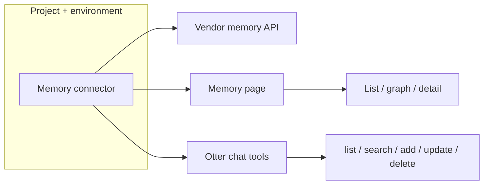

**Memory connectors** attach OpenLIT to external agent memory providers. Use them to browse stored facts, search semantically, add or edit memories, copy between backends, and ask **Otter** questions grounded in connector data.

Add memory connectors from **Configuration → Connectors** (`/connectors`) under the **Memory** category, or directly from the **Memory** page (`/memory`) when no connector exists yet. Connectors are scoped to the current [project](/latest/openlit/organisation/projects) and [environment](/latest/openlit/organisation/environments).

<Info>
Memory connectors use the same atomic registry as [data-source connectors](/latest/openlit/connectors/datasource), but they do not participate in telemetry signal routing. Credentials are encrypted on the connector instance rather than the ClickHouse vault.
</Info>

## Mental model

- **Atomic connectors** — one Mem0 project endpoint, one Zep tenant, one Claude memory store configuration, one LangGraph server, one Cognee server, or one Supermemory account per connector instance.
- **Capability-driven UI** — each vendor advertises supported operations (`list`, `search`, `add`, `update`, `delete`, `feedback`). OpenLIT hides actions the vendor does not support.
- **Filters** — user, session/run, and agent filters are declared per vendor. Some connectors require a session or user before listing memories.
- **Port links** — copying a memory to another connector stores provenance metadata so you can trace copies back to the source.

## Supported memory connectors

| Connector | Default endpoint | What it's for |
| --- | --- | --- |
| **Claude** | `https://api.anthropic.com` | Browse and edit memories in Anthropic Claude memory stores (Managed Agents memory beta) |
| **Cognee** | None — enter your server URL | Browse, search, and edit the documents and knowledge graph of a Cognee dataset (Cognee Cloud or self-hosted) |
| **Mem0** | `https://api.mem0.ai` | Store and search long-term agent memories scoped by user, run, or agent |
| **Supermemory** | `https://api.supermemory.ai` | Store documents and search the long-term memories Supermemory extracts, scoped by namespace |
| **Zep** | `https://api.getzep.com` | Session memory and knowledge-graph facts for agents |
| **LangGraph** | None — enter your server URL | Long-term memories in the Store of a LangGraph Platform deployment or self-hosted LangGraph server |

Self-hosted Mem0, Zep, Cognee, or Supermemory deployments work when you point the connector at a compatible API URL and supply the same authentication style as the hosted service.

## Capability matrix

| Connector | List | Search | Get | Add | Update | Delete | Feedback | Required filters |
| --- | --- | --- | --- | --- | --- | --- | --- | --- |
| **Claude** | Yes | Yes* | Yes | Yes | Yes | Yes | No | Memory store (session) |
| **Cognee** | Yes | Yes§ | Yes | Yes¶ | Yes¶ | Yes | No | Dataset (session) |
| **Mem0** | Yes | Yes | Yes | Yes | Yes | Yes | Yes | Optional user / run / agent |
| **Supermemory** | Yes◆ | Yes | Yes | Yes▲ | No■ | Yes● | No | Namespace (user) |
| **Zep** | Yes | Yes | Yes | Yes | No | Yes† | No | User; session required for writes |
| **LangGraph** | Yes | Yes‡ | Yes | Yes | Yes | Yes | No | Namespace (session) for writes, or the template's placeholders |

\* Claude has no dedicated search API — OpenLIT filters listed memories locally for search queries.

† Zep delete targets graph edges/nodes, not an entire session.

‡ LangGraph search is semantic only when the server has a store index configured. Without one, LangGraph ignores the query and returns items in listing order with no relevance score; OpenLIT does not emulate semantic search.

§ Cognee search is a vector search over the dataset's stored passages (`CHUNKS`). It never calls an LLM, so it works before the graph is built. Hits from one document are merged into one result. Cognee reports a raw distance, not a similarity, so results carry no score.

¶ A Cognee memory is a document in a dataset. Adding one stores the text and then asks Cognee to build the dataset's knowledge graph, which uses the LLM configured on your Cognee server and can take minutes; the memory shows up immediately and its graph follows. If starting the build fails, the memory is still stored and the detail sheet says so. Updating a memory replaces the document's text and rebuilds its graph before answering, so it can be slow. Cognee has no document-level metadata update, so an update changes the text only, and the `node_set` metadata key is reserved by Cognee and dropped on write. The list shows each document's name; open it to read the stored text.

◆ Supermemory lists the memories it extracted, not the documents you added. Only the latest version of each memory is listed.

▲ Adding text to Supermemory stores a **document**. Supermemory then extracts memories from it in the background, so new memories appear in the list and search after processing finishes (minutes with the default grouping). The record returned by the add is the document (its id is marked `document:`), so opening or deleting it acts on the document, not on a memory. Metadata values must be strings, numbers, booleans, or lists of strings; other values are not sent.

■ The Supermemory v5 API has no route to write or edit a single memory. Update the source document in Supermemory instead.

● Delete **forgets** the memory. It leaves the list and search, but Supermemory keeps it readable by id, marked forgotten.

## Add a memory connector

<Steps>
  <Step title="Select project and environment">
    Use the header selectors for the target [project](/latest/openlit/organisation/projects) and [environment](/latest/openlit/organisation/environments).
  </Step>
  <Step title="Open Connectors">
    Go to **Configuration → Connectors**, open the **Memory** section in the catalog, and choose **Add connector**.
  </Step>
  <Step title="Pick a vendor">
    Select **Claude**, **Cognee**, **LangGraph**, **Mem0**, **Supermemory**, or **Zep**.
  </Step>
  <Step title="Configure endpoint and credentials">
    Set the API URL (defaults work for hosted services), optional SSRF toggles for private networks, and the API key. Mem0 also accepts optional organization and project IDs. LangGraph has no default URL, an optional API key, and an optional namespace template (see [LangGraph namespaces](#langgraph-namespaces)). Cognee has no default URL and an optional API key; pick the dataset on the Memory page. Supermemory takes an API key that can list namespaces; pick the namespace on the Memory page.
  </Step>
  <Step title="Test and save">
    Run a health check, then save. Open **Memory** (`/memory`) and select the connector from the dropdown.
  </Step>
</Steps>

<Tip>
You can also add a connector from the Memory page empty state — **Add memory connector** opens the same add dialog.
</Tip>

## Memory page features

Once a connector is configured, the **Memory** page provides:

| Feature | Description |
| --- | --- |
| **Connector selector** | Switch between memory connectors in the current environment |
| **Filters** | User, session/run, and agent filters when the vendor supports them |
| **Memory list** | Paginated list with search |
| **Detail sheet** | Full memory content, metadata, history, and feedback (when supported) |
| **Graph view** | Relationship visualization for graph-capable vendors (for example Zep and Cognee) |
| **Write actions** | Add, update, or delete memories when the connector advertises those capabilities |
| **Copy** | Copy selected memories to another write-capable connector in the same environment |
| **Ask Otter** | Natural-language search and Q&A grounded in connector list/search APIs |

## Otter memory tools

When Otter runs on the Memory page or in chat with memory context, it can call connector-backed tools:

| Tool | When available |
| --- | --- |
| `list_memories` | Connector supports `list` |
| `search_memories` | Connector supports `search` |
| `add_memory` | Connector supports `add` |
| `update_memory` | Connector supports `update` |
| `delete_memory` | Connector supports `delete` |

Otter passes required filter arguments (user, session, agent) when the vendor mandates them. [Enterprise](/latest/openlit/enterprise) builds apply the same [RBAC](/latest/openlit/rbac) and [audit](/latest/openlit/audit-logs) hooks as the `/api/memory` routes.

## Authentication

| Connector | Auth style | Notes |
| --- | --- | --- |
| **Claude** | API key (`x-api-key`) | Sends the `agent-memory-2026-07-22` beta header for memory store APIs |
| **Mem0** | Token (`Authorization: Token <apiKey>`) | Works with Mem0 Platform or self-hosted compatible endpoints |
| **Zep** | API key (`Authorization: Api-Key <apiKey>`) | Works with Zep Cloud or self-hosted compatible endpoints |
| **Cognee** | None, or API key (`X-Api-Key`) | Leave the key empty for self-hosted servers with authentication disabled. Login tokens (Bearer) are not supported |
| **Supermemory** | Bearer (`Authorization: Bearer <apiKey>`) | Works with Supermemory Cloud or a self-hosted server. The key must be allowed to list namespaces, which the connection test uses |
| **LangGraph** | None, or API key (`x-api-key`) | Leave the key empty for self-hosted servers without auth; use a LangSmith API key for LangGraph Platform. Bearer tokens and custom auth handlers are not supported |

API keys are stored encrypted on the connector (`enc:v1:…`) and decrypted only server-side for outbound requests.

## LangGraph namespaces

LangGraph Store items live in a namespace (an ordered list of labels) under a key. LangGraph gives namespace labels no meaning of their own, so OpenLIT only maps them to user, session, and agent filters when you declare it with a **namespace template**:

| Namespace template | Behaviour |
| --- | --- |
| *(empty)* | Each discovered namespace is a **Namespace or thread** (session) filter, for example `memories.u1`. Writes go to the selected namespace. |
| `memories` | Same, limited to namespaces under `memories`. |
| `memories/{user_id}` | The second label is the user. |
| `memories/{user_id}/{thread_id}/{assistant_id}` | Labels map to user, session (thread), and agent filters. Writes need a value for every placeholder. |

Fixed template segments must match exactly; placeholders are `{user_id}`, `{thread_id}`, and `{assistant_id}`. Labels cannot be empty or contain `.`. Items deeper than the template still match; items that do not fit it are hidden.

Memory content is read from the LangMem shapes `{"kind": ..., "content": {"content": "..."}}` and `{"content": "..."}`, falling back to the JSON of the whole value, including arrays and primitives. The original value is always shown in metadata under `langgraph`. New memories are written as `{"content": "..."}`. Updates change only the field the content was read from and keep every other field. OpenLIT refuses to edit a value that is not an object, or a non-text `content` or `metadata` field, because that would overwrite data. Because LangGraph has no compare-and-swap, an update can overwrite a concurrent change made between OpenLIT's read and write.

## Cognee datasets and graph

Cognee keeps memory in **datasets**, so the Memory page's filter is a **Dataset** (pick one, or type a name to create it on the first write). The graph view draws the whole dataset's knowledge graph from Cognee's own graph route: documents are memories (click one to open it), and the entities and relationships Cognee extracted are drawn around them. Cognee builds the graph asynchronously, so a dataset that was just written to can show documents with no entities yet. At most 600 nodes are drawn, keeping the best-connected ones first.

## Supermemory namespaces

Every Supermemory route is scoped to one **namespace**, shown as the **Namespace** filter (listed from your account, or typed). Memory ids carry the namespace, so a memory opened from the list or from search is always read from the namespace it came from. Supermemory's public API has no graph route, so the graph is derived from the loaded memories like other connectors without one.

## Copy between connectors

Use **Copy** on the Memory page to duplicate memories into another write-capable connector in the same project and environment. OpenLIT:

1. Reads the source memory from the origin connector
2. Writes to the destination connector when `add` is supported
3. Stores `metadata.openlit.port` on the destination memory and links the destination connector back to the source for traceability

In [OpenLIT Enterprise](/latest/openlit/enterprise), copying requires the `connectors:update` permission, or the equivalent memory permission under [role-based access control](/latest/openlit/rbac).

## Security and reliability

- Endpoints validated (`http`/`https` only); credentials in URLs rejected; private/metadata SSRF targets blocked where applicable.
- Secrets encrypted on the connector instance, redacted from errors, never logged.
- Outbound calls use the shared safe-fetch layer with the same SSRF controls as data-source connectors.
- Content limits: memory body up to 20,000 characters; metadata JSON up to 4,000 characters.

## Vendor documentation

<CardGroup cols={3}>
  <Card title="Claude memory" href="https://platform.claude.com/docs/en/managed-agents/memory" icon="book">
    Anthropic Managed Agents memory stores.
  </Card>
  <Card title="Cognee API" href="https://docs.cognee.ai/api-reference/introduction" icon="book">
    Cognee REST API reference.
  </Card>
  <Card title="Mem0 API" href="https://docs.mem0.ai/api-reference" icon="book">
    Mem0 Platform REST API reference.
  </Card>
  <Card title="Supermemory API" href="https://api.supermemory.ai/v5/reference" icon="book">
    Supermemory v5 API reference.
  </Card>
  <Card title="Zep SDK" href="https://help.getzep.com/sdk-reference" icon="book">
    Zep Cloud API and graph memory.
  </Card>
  <Card title="LangGraph Agent Server" href="https://docs.langchain.com/langsmith/agent-server" icon="book">
    LangGraph server and Store API.
  </Card>
</CardGroup>

## Related

<CardGroup cols={2}>
  <Card title="Connectors overview" href="/latest/openlit/connectors/overview" icon="plug">
    Shared connector registry and project scope.
  </Card>
  <Card title="Data-source connectors" href="/latest/openlit/connectors/datasource" icon="database">
    Tempo, Loki, Prometheus, Jaeger, and ClickHouse.
  </Card>
  <Card title="Scanner connectors" href="/latest/openlit/connectors/scanner" icon="magnifying-glass">
    Trustabl scans of GitHub repositories.
  </Card>
  <Card title="Otter (AI Copilot)" href="/latest/openlit/chat/overview" icon="message">
    Chat with Otter across OpenLIT surfaces.
  </Card>
  <Card title="Environments" href="/latest/openlit/organisation/environments" icon="layer-group">
    Partition memory connectors by environment.
  </Card>
</CardGroup>
